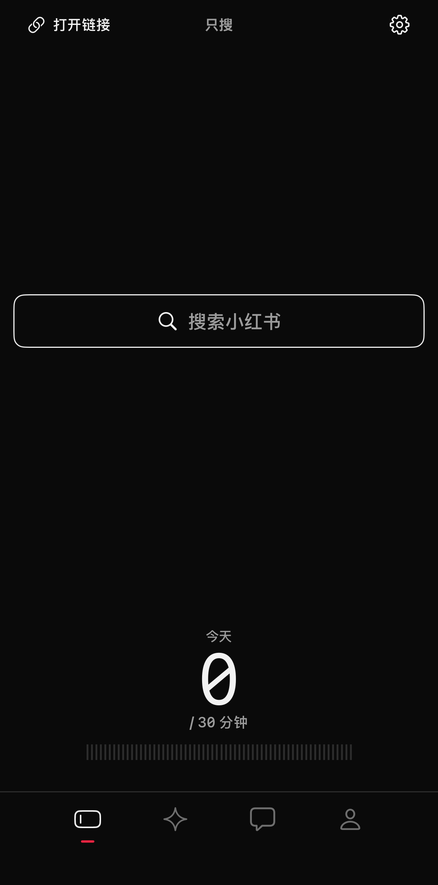
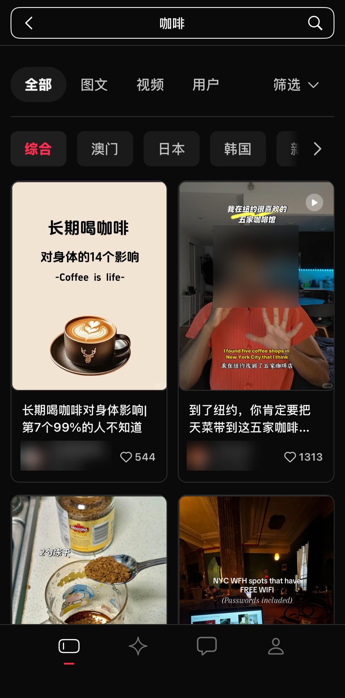
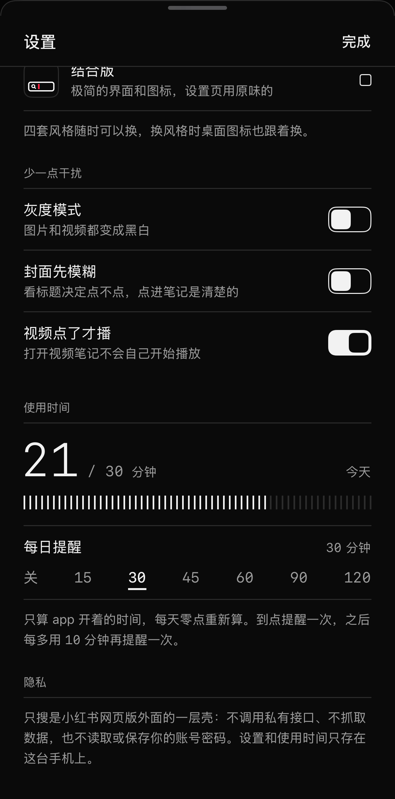
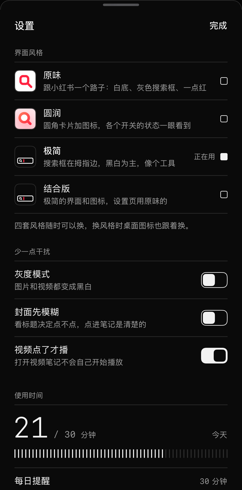
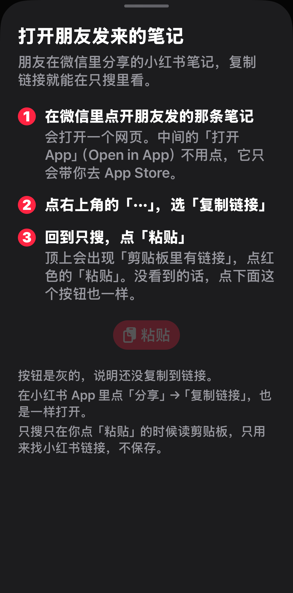

# 只搜 Search Only (xhs-search-only)

**An iPhone app for Xiaohongshu (RedNote) that keeps search and removes the recommendation feed. Search, read, leave.**

[中文](README.md)

Xiaohongshu is a great place to search for first-hand experience, but opening it usually means losing an hour to the home feed. Search Only wraps the Xiaohongshu website: the app opens to a search box and nothing else.

| Home | Search results | A note |
| --- | --- | --- |
|  |  |  |

| Usage time and switches | Four UI styles | Open a shared note |
| --- | --- | --- |
|  |  |  |

The screenshots show the "minimal" style in dark mode. Other people's avatars and names are blurred. The app's interface is in Chinese.

## Features

- **Opens to a search box.** Home, Explore, Video and Live feeds are never shown.
- **Search results, notes, comments, profiles, messages and your own page work as usual.** You sign in on Xiaohongshu's own web login page.
- **Usage time**: see how many minutes you used today, with an optional daily reminder (15 to 120 minutes).
- **Three "less distraction" switches**: grayscale, blurred covers, and videos that only play when tapped.
- **Open a note a friend shared**: copy the link, switch to the app, tap Paste.
- **Four UI styles**, switchable in Settings. The home-screen icon changes with the style.
- **Home-screen and lock-screen widgets** that jump straight to search.

## Install

The app is not on the App Store. There are two ways to use it.

### Option 1: build it onto your own iPhone with Xcode

You need a Mac, Xcode, an Apple ID (a free one works) and an iPhone on iOS 17 or later.

1. Download this repository (Code → Download ZIP, or `git clone`).
2. Open `SearchOnly.xcodeproj` in Xcode.
3. Set your own signing, either way:
   - Create `Local.xcconfig` next to `Signing.xcconfig` with:

     ```
     DEVELOPMENT_TEAM = YOUR_TEAM_ID
     SO_BUNDLE_ID = com.yourname.searchonly
     ```

     The team ID is shown in Xcode → Settings → Accounts. The file is git-ignored.
   - Or pick your team and change the Bundle Identifier for both the SearchOnly and SearchOnlyWidget targets under Signing & Capabilities.
4. Connect the iPhone, select it in Xcode and press Run.
5. The first time, trust the developer on the phone under Settings → General → VPN & Device Management.

Apps signed with a free Apple ID **expire after 7 days**; connect to the Mac and run again. A paid developer account lasts a year.

### Option 2: the userscript only (no Xcode)

[`xhs-search-only.user.js`](xhs-search-only.user.js) does the same job in a browser on the Xiaohongshu website: feed pages become a search box, everything else is untouched. It has none of the app-only features such as usage time or grayscale.

| Browser | Extension | How to add the script |
| --- | --- | --- |
| Safari on Mac / iPhone / iPad | [Userscripts](https://apps.apple.com/app/userscripts/id1463298887) (free, open source) | Open the extension page → "+" → New JS → paste the script → save, then allow the extension on xiaohongshu.com |
| Chrome / Edge / Firefox | Tampermonkey or Violentmonkey | Extension menu → new script → paste the script → save |

## How it works, and privacy

- The app is a shell around the Xiaohongshu website: a `WKWebView` plus a few injected scripts and styles. **It calls no private APIs, scrapes no data, and never reads or stores your account password.** Sign-in happens on Xiaohongshu's own page.
- It works by URL allow-list: search results, notes, profiles, messages and login load normally; feed pages are replaced with a search box.
- Apart from loading the Xiaohongshu website, the app contacts no other server and has no analytics. Settings and usage time stay on your phone.
- Clipboard: read only when you tap Paste, only to find a Xiaohongshu link, and not stored.

## Known limits

- When Xiaohongshu changes its website, the allow-list or page styles may need updating, and some pages may look wrong until then.
- Search results themselves and the related notes under a note are not filtered.
- Search speed depends on Xiaohongshu's servers.
- Tested on iPhone only. No iPad or Android version.

## Feedback

Issues are welcome, in Chinese or English.

## Disclaimer

This is an unofficial personal project with no affiliation with Xiaohongshu (Xingyin Information Technology). "Xiaohongshu" and "RedNote" are trademarks of their owner. The app only changes how the site is displayed on your own device. Follow Xiaohongshu's terms of service; use at your own risk.

## License

[MIT](LICENSE)
