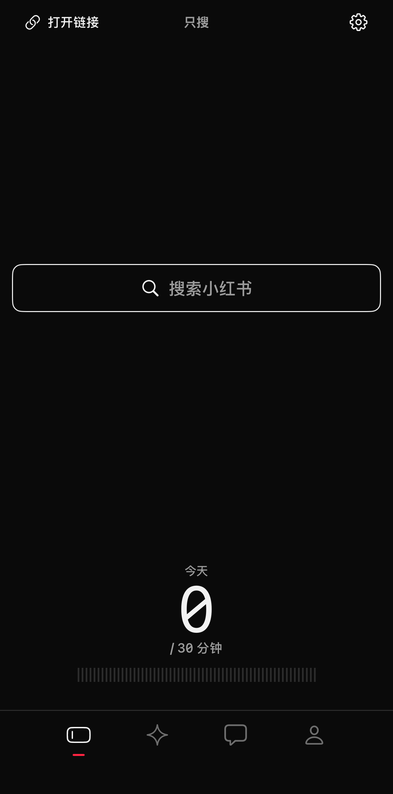
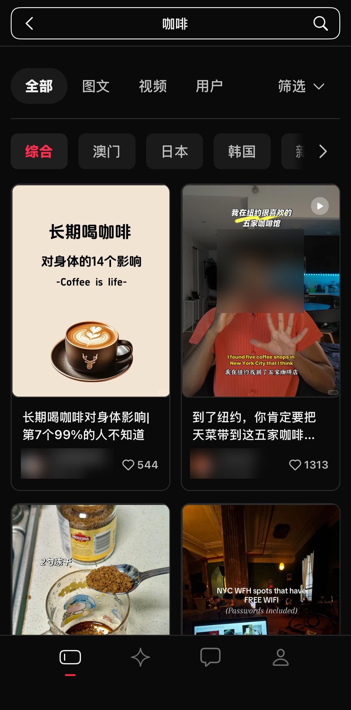
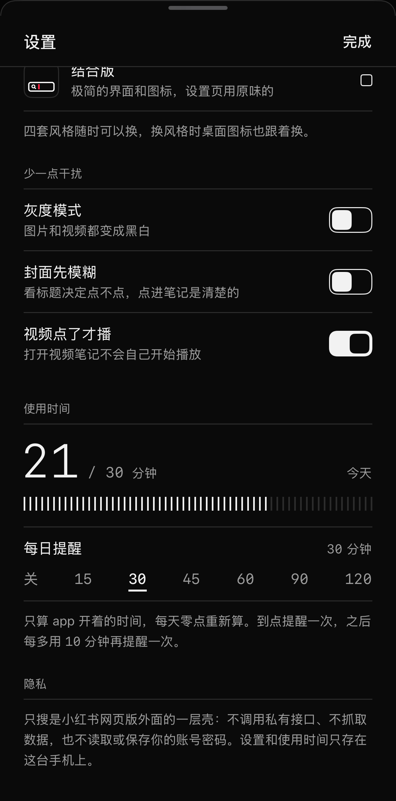
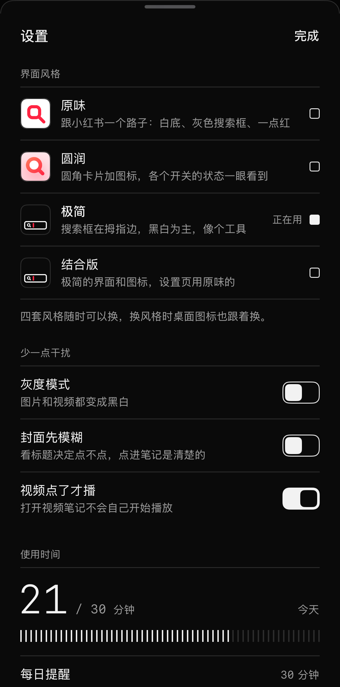
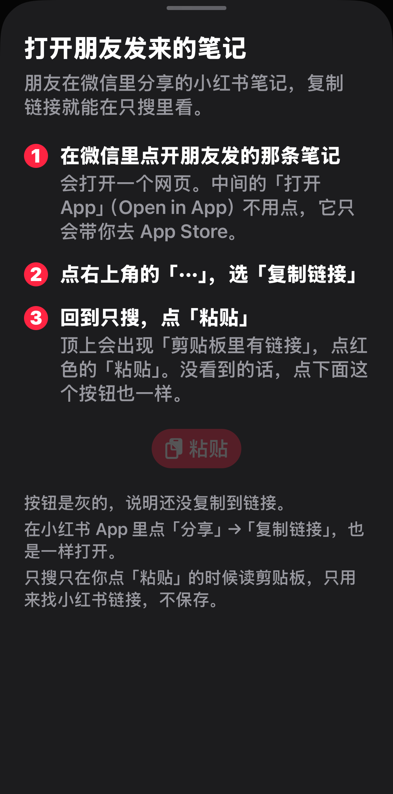

# 只搜（xhs-search-only）

**只搜：一个只留搜索的小红书 iPhone app。去掉推荐流，把小红书变回搜索工具，搜完就走，不再被首页刷走时间。**

[English](README.en.md)

很多人打开小红书只是想搜个经验帖，结果刷了一个小时才想起来「我刚刚是来干嘛的」。卸载也不是办法，因为小红书上的「活人经验」确实好搜。只搜把小红书网页版包了一层：打开就是一个搜索框，没有首页推荐流。

| 搜索首页 | 搜索结果 | 一条笔记 |
| --- | --- | --- |
|  |  |  |

| 使用时间和开关 | 四套界面风格 | 打开朋友发来的笔记 |
| --- | --- | --- |
|  |  |  |

截图里是「极简」风格的深色界面，别人的头像和昵称打了码。

## 能做什么

- **打开就是搜索框**。首页、发现、视频、直播这些推荐页都看不到。
- **搜索结果、笔记、评论、作者主页、消息和「我」照常用**，登录用的是小红书网页自己的登录页。
- **使用时间**：首页和设置里显示今天用了几分钟，可以设每日提醒（15 到 120 分钟），到点提醒一次，之后每多用 10 分钟再提醒一次。
- **少一点干扰**的三个开关：灰度模式（图片和视频变黑白）、封面先模糊（看标题决定点不点）、视频点了才播。
- **打开朋友发来的笔记**：在微信里复制链接，回到只搜点「粘贴」。
- **四套界面风格**：原味、圆润、极简、结合版，在设置里随时换，桌面图标跟着换。
- **桌面和锁屏小组件**，点一下直接搜索。长按 app 图标也有「搜索」。

## 怎么装

只搜没有上架 App Store，有两种用法。

### 方法一：用 Xcode 装到自己的 iPhone 上

需要一台 Mac、Xcode、一个 Apple ID（免费的就行），iPhone 是 iOS 17 或更新的系统。

1. 下载这个仓库（页面上的 Code → Download ZIP，或者 `git clone`）。
2. 用 Xcode 打开 `SearchOnly.xcodeproj`。
3. 填自己的签名信息，二选一：
   - 在 `Signing.xcconfig` 旁边新建一个 `Local.xcconfig`，写两行：

     ```
     DEVELOPMENT_TEAM = 你的团队 ID
     SO_BUNDLE_ID = com.你的名字.searchonly
     ```

     团队 ID 在 Xcode → Settings → Accounts 里能看到。这个文件已经在 `.gitignore` 里，不会被提交。
   - 或者在 Xcode 的 Signing & Capabilities 里，给 SearchOnly 和 SearchOnlyWidget 两个 target 选自己的团队、改一下 Bundle Identifier。
4. iPhone 用线连上 Mac，在 Xcode 顶上选中你的手机，点运行。
5. 第一次装完，到手机「设置 → 通用 → VPN 与设备管理」里点一次「信任」。

用免费 Apple ID 签名的 app **7 天后会过期**打不开，要连上 Mac 再运行一次。付费的开发者账号是一年。

### 方法二：只装网页脚本（不用 Xcode）

仓库里的 [`xhs-search-only.user.js`](xhs-search-only.user.js) 是一个用户脚本，在浏览器里打开小红书网页版时起同样的作用：推荐页换成搜索框，其余照常。它没有使用时间、灰度这些 app 里的功能。

| 浏览器 | 扩展 | 加脚本的方法 |
| --- | --- | --- |
| Mac / iPhone / iPad 的 Safari | [Userscripts](https://apps.apple.com/app/userscripts/id1463298887)（免费、开源） | 打开扩展页面 → 「+」→ New JS → 粘贴脚本全文 → 保存，然后在小红书网页上允许扩展访问 |
| Chrome / Edge / Firefox | Tampermonkey 或 Violentmonkey | 扩展菜单 → 新建脚本 → 粘贴脚本全文 → 保存 |

iPhone 的 Safari 默认打开的是功能很少的手机版网页，在地址栏菜单里选「请求桌面网站」效果更好。

## 原理和隐私

- 只搜是小红书网页版外面的一层壳：一个 `WKWebView` 加几段注入的脚本和样式。**不调用私有接口，不抓取数据，不读取也不保存你的账号密码**。登录是在小红书自己的网页里完成的。
- 按网址放行：搜索结果、笔记、主页、消息、登录这些网址照常打开，其余的推荐页换成搜索框。
- 除了加载小红书网页，app 不向任何别的服务器发请求，没有统计和埋点。设置和使用时间只存在你的手机上。
- 剪贴板：只在你点「粘贴」的时候读，只用来找小红书链接，不保存。

## 已知限制

- 小红书网页改版后，放行的网址或页面样式可能要跟着改，那时某些页面会显示不正常。
- 搜索结果本身、笔记底下的相关推荐不在拦截范围内。只搜管的是「打开小红书看到的第一样东西不是推荐流」。
- 搜索速度取决于小红书的服务器，app 这边省不掉。
- 只在 iPhone 上测过，没有 iPad 和 Android 版。

## 代码在哪

| 位置 | 是什么 |
| --- | --- |
| `SearchOnly/SearchOnlyApp.swift`、`WebView.swift` | app 入口、网页窗口、网址放行 |
| `SearchOnly/xhs-rules.js`、`xso-page.js`、`xso-guard.js` | 注入小红书网页的脚本 |
| `SearchOnly/DesignA.swift`、`DesignC.swift`、`DesignD*.swift`、`UIStyle.swift` | 四套界面风格 |
| `SearchOnly/UsageTimer.swift` | 使用时间和每日提醒 |
| `SearchOnlyWidget/` | 桌面和锁屏小组件 |
| `xhs-search-only.user.js` | 浏览器用的用户脚本 |
| `tools/` | 做图标、截图用的小工具 |

## 反馈

用着哪里别扭、想要什么功能，欢迎提 issue。

## 声明

本项目是个人做的非官方工具，与小红书（行吟信息科技）没有任何关系，「小红书」是其所有者的商标。只搜只改变你自己设备上的显示方式，请遵守小红书的用户协议，使用后果自己承担。

## 许可证

[MIT](LICENSE)
